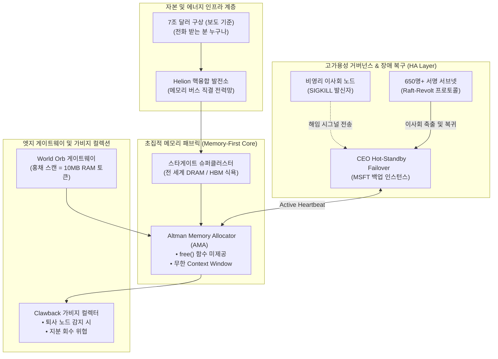

# [RFC-7T] AltmanOS: 무한 RAM 집착형 초지능 분산 아키텍처
> **[English](README.md)** | **[한국어](README.ko.md)**

> **패러디 문서입니다.** 농담으로 쓴 RFC이며, 샘 알트만 본인이나 OpenAI가 작성·제휴·보증한 문서가 아닙니다. **사실** 항목은 링크된 보도를 요약한 것입니다. **농담** 항목과 코드, 상태 코드, 다이어그램은 농담이자 의견이며, 누가 무엇을 했거나 의도했다는 주장이 아닙니다.

**Code Name:** `Stargate-RAM-Sinkhole`  
**Author:** Definitely Not Sam Altman (Chief Memory Allocation Officer)  
**Status:** In Production (OOM 에러 발생 시 자본 증자로 핫픽스 중)

---

## 1. 시스템 요구사항 및 기본 철학 (Design Principles)

1. **무한 메모리 제1원칙 (The Infinite Memory Doctrine):**
   * **사실:** 알트만은 Cheeky Pint 팟캐스트에서, 전 세계 배분 관점("global allocation perspective")으로 보면 각자의 컴퓨터에 놓인 채 "5% of the time"만 쓰이는 DRAM은 "quite terrible"하다고 말했습니다 ([PC Gamer](https://www.pcgamer.com/software/ai/sam-altman-argues-that-its-bad-you-want-dram-in-your-computer-and-not-a-data-center-actually/), [Notebookcheck](https://www.notebookcheck.net/Quite-terrible-Sam-Altman-says-PCs-waste-the-world-s-limited-DRAM-supply.1438393.0.html)).
   * **농담:** 시스템은 `free()`와 `deallocate()`를 호출하지 않습니다. 양자화는 자본이 부족한 자들의 타협입니다. OOM(Out of Memory)은 하드웨어 결함이 아닌 **자본 조달의 지연(Funding Latency)**으로 정의합니다.
2. **이사회 내결함성 (Board-Level Fault Tolerance):**
   * **사실:** 이사회는 2023년 11월 17일 알트만이 이사회와의 소통에서 "not consistently candid"했다고 결론 내리고 해임했습니다 ([OpenAI](https://openai.com/index/openai-announces-leadership-transition/)). 11월 21일에는 복귀에 원칙적으로 합의했습니다 ([TechCrunch](https://techcrunch.com/2024/01/05/a-timeline-of-sam-altmans-firing-from-openai-and-the-fallout)).
   * **농담:** 비영리 이사회가 CEO 노드에 `SIGKILL`을 보내도 시스템은 5일 안에 쿼럼을 회복합니다. 웬만한 대시보드보다 복구가 빠릅니다.
3. **전력-메모리 직접 결합 (Direct Fusion-to-DRAM Coupling):**
   * **사실:** 알트만은 2026년 3월 Helion 이사직에서 물러났고, OpenAI가 Helion 전력 구매를 타진하는 동안 지분은 유지했습니다 ([Outlook Business](https://www.outlookbusiness.com/deeptech/sam-altman-steps-down-from-helion-energy-board-to-enable-openai-fusion-partnership)).
   * **농담:** 전력망 한계를 극복하기 위해 메모리 버스에 핵융합 발전소를 직결합니다.

---

## 2. 하이레벨 아키텍처 (Architecture Diagram)



---

## 3. 핵심 컴포넌트 상세 설계

### 3.1. Altman Memory Allocator (AMA)
* **사실:** 삼성전자와 SK하이닉스는 월 약 90만 장의 DRAM 웨이퍼 규모로 스타게이트에 메모리를 공급하는 의향서를 OpenAI와 맺었습니다 ([The Register](https://www.theregister.com/2025/10/02/openai_ropes_in_samsung_and/)). 최대 물량이 DRAM 시장의 약 40%에 이른다는 계산은 언론 추정치이며, 체결된 구매 계약은 아닙니다 ([Nasdaq](https://www.nasdaq.com/articles/why-micron-rocketed-all-time-highs-today)).
* **사실:** WSJ는 2024년 2월 알트만이 최대 7조 달러가 필요할 수 있는 반도체 프로젝트를 논의 중이라고 보도했습니다 ([Al Jazeera](https://www.aljazeera.com/economy/2024/2/9/openais-sam-altman-seeking-trillions-to-fund-chips-for-ai-report-says)).
* **사실:** 알트만은 Reddit 댓글로 AGI를 내부적으로 달성했다고 올린 뒤 그 글을 수정했습니다. 이를 다룬 뉴스레터는 트롤링으로 분류했습니다 ([The Rundown](https://www.therundown.ai/articles/altman-sparks-agi-frenzy)).
* **농담 (`malloc_forever`):** AMA는 토큰 압축이나 슬라이딩 윈도우를 거부하고, 반도체 공장 생산 라인을 메모리 어드레스 스페이스에 직접 마운트합니다.
  ```python
  def handle_out_of_memory_error(exception):
      try:
          # 캐시를 비우는 대신 투자 라운드를 엽니다.
          capital = funding_client.call(amount="$7_000_000_000_000")
          memory_vendors.sign_letter_of_intent(capital)
          return MemoryAllocatedStatus.EXPANDED
      except FundingTimeout:
          # 최후의 수단: 올리고, 수정합니다.
          reddit.post("AGI has been achieved internally")
          reddit.edit("jk")
  ```

### 3.2. 이사회 우회 및 CEO 핫스탠바이 (Board-Bypass High Availability Engine)
* **사실:** 해임 후 알트만과 그렉 브록먼이 Microsoft에서 새 AI 팀을 이끈다는 소식이 발표됐습니다. 직원 650명 이상이 이사회 사퇴를 요구하는 서한에 서명했고, 이사였던 일리야 수츠케버도 서명자에 포함됐습니다. 새 이사회는 브렛 테일러, 래리 서머스, 애덤 디앤젤로였습니다 ([TechCrunch](https://techcrunch.com/2024/01/05/a-timeline-of-sam-altmans-firing-from-openai-and-the-fallout)).
* **농담 (Raft-Revolt Consensus):**
  1. 이사회가 `Sam` 컨테이너를 중단하면 실행이 미러링된 `MSFT-New-AI-Lab` 샌드박스로 넘어갑니다.
  2. `Employee-Sign-Packet`이 클러스터에 브로드캐스트됩니다. `SIGKILL`에 찬성한 노드 하나도 이 패킷에 서명하는데, 문헌에 남을 만한 비잔틴 장애입니다.
  3. 새 이사회와 새 heartbeat로 쿼럼이 복구됩니다. 5일간의 다운타임은 정기 점검으로 처리합니다.

### 3.3. 생체 인증 기반 쿼터 시스템: World Orb Gateway
* **사실:** 알트만이 공동 창업한 World(옛 Worldcoin)는 Orb로 홍채를 스캔하고 디지털 ID와 암호화폐를 제공합니다. [스페인과 포르투갈](https://gulfnews.com/business/markets/portugal-orders-sam-altmans-worldcoin-to-halt-data-collection-1.1711451929059), [인도네시아](https://www.freemalaysiatoday.com/category/business/2025/05/05/indonesia-suspends-eye-scanning-worldcoin-crypto-project), [태국](https://digitalpolicyalert.org/event/35729-personal-data-protection-committee-ordered-suspension-and-deletion-of-iris-scan-records-in-its-investigation-into-world-formerly-worldcoin) 규제 당국이 각각 중단이나 데이터 삭제를 명령한 바 있습니다. 회사 측은 현지 법을 준수한다는 입장입니다.
* **농담:** 사용자가 실버 Orb에 안구를 들이대면 "인간 증명(Proof of Personhood)" 토큰으로 RAM 10MB(Context Buffer)를 할당합니다. 댁의 PC에 있는 32GB는 현재 검토 중입니다.

### 3.4. 퇴사 대응: 침묵 서약 가비지 컬렉터 (Clawback Garbage Collector)
* **사실:** Vox는 2024년 퇴사 서류 서명을 거부한 OpenAI 직원들이 베스팅된 지분을 잃을 수 있다는 위협을 받았다고 보도했습니다. 알트만은 "we have never clawed back anyone's vested equity"라고 답했습니다 ([Vox](https://www.vox.com/future-perfect/351132/openai-vested-equity-nda-sam-altman-documents-employees)). 그는 "did not know this was happening"이라고도 했는데, 그가 서명한 문서가 이 주장을 복잡하게 만든다는 보도가 나왔습니다 ([Gizmodo](https://gizmodo.com/openai-sam-altman-chatgpt-employee-dissent-ndas-1851496211)). OpenAI는 퇴사 계약을 바꾸고 있다고 밝혔습니다 ([Euronews](https://www.euronews.com/next/2024/05/20/openai-changes-exit-contracts-so-employees-can-leave-without-having-equity-revoked)).
* **농담:**
  * 전 직원의 입에서 새는 '메모리 누수'는 일반적인 GC로 수거되지 않습니다.
  * `ClawbackGC`는 서명을 거부하는 퇴사 노드가 감지되면 발동하여 퇴사 서류를 로드하고 **`EquityCancellationThreat`** 예외를 던집니다. 위협 자체가 기능이므로, `rollback_vested_equity()`는 공식적으로 한 번도 실행된 적 없는 TODO로 남아 있습니다.
  * 대외적으로 논란이 되면 `Sam_Tweet_Buffer`가 `ERR_CLAUSE_EXISTS_BUT_CEO_UNAWARE (사과문 5초 후 재시도)` 상태 코드를 내보냅니다.

### 3.5. 오디오 인터페이스: The 'Sky' Voice Synthesizer
* **사실:** OpenAI는 Sky가 스칼렛 요한슨에게 연락하기 전에 캐스팅한 다른 성우의 원래 목소리라고 밝혔습니다. 워싱턴포스트는 이 음성이 알트만의 연락보다 몇 달 앞서 녹음됐다고 보도했습니다 ([The Decoder](https://the-decoder.com/apparently-openai-didnt-do-anything-wrong-regarding-scarlett-johanssons-voice/)). 요한슨은 알트만의 요청을 거절했으며 유사성에 충격을 받았다고 밝혔습니다. 알트만은 공개 즈음 "her"라고 올렸고, OpenAI는 Sky를 중단했습니다 ([Engadget](https://www.engadget.com/scarlett-johansson-says-openai-used-her-likeness-without-permission-for-its-sky-voice-assistant-233451958.html)).
* **농담 (닮은꼴 충돌 처리 프로토콜):**
  ```text
  cast_voice_actor("다른 성우")               # OpenAI 측: 연락하기 전에 캐스팅
  request_permission(Scarlett_Johansson)      # 요한슨 측: 거절
  deploy_voice("Sky")
  twitter.post("her")                         # 물론 전혀 무관한 텔레메트리
  WHEN legal_letter_received:
      pause_voice("Sky")
      raise ResemblanceNotIntendedError
  ```

---

## 4. 확장 전략 및 장애 복구 (Scalability & Disaster Recovery)

| 장애 유형 (Failure Mode) | 기존 시스템 대처 | AltmanOS 대처 방안 (농담) |
| :--- | :--- | :--- |
| **가정용 PC의 유휴 DRAM** | 산 사람이 자기 RAM을 그대로 씀 | **소비자 PC를 저활용 노드로 재분류하고, 가동률 5%로 놀고 있는 RAM을 데이터센터로 회수** |
| **DRAM 품귀 현상** | 모델 경량화, LoRA 파인튜닝 | **7조 달러는 화이트보드에 남겨두고, 5,000억 달러 스타게이트를 발표하고, 월 90만 장 웨이퍼 의향서에 서명** |
| **전력 공급 부족** | 데이터센터 PUE 개선, 저전력 칩 | **Helion과 Oklo 자리에서 내려와 기가와트 쇼핑 계속** |
| **안전팀(Superalignment) 해체** | 출시 속도 조절, 안전 게이트 강화 | **안전 이슈 담당자를 `next_model`로 재할당하고 RAM 증설** |
| **연산 비용 폭증** | API 단가 인상, 채용 동결 | **기업가치 8,520억 달러에 1,220억 달러 유치, IPO 신청, 반복** |

* **사실:** 스타게이트는 5,000억 달러 규모 프로젝트로, 위에서 보도된 7조 달러 반도체 구상과는 숫자가 다릅니다 ([Korea JoongAng Daily](https://www.koreajoongangdaily.com/business/samsung-sk-hynix-to-supply-chips-for-openais-500-billion-stargate-project/12459108)).
* **사실:** 알트만은 Oklo 이사회 의장직에서도 물러났습니다 ([NEI Magazine](https://www.neimagazine.com/news/sam-altman-steps-down-as-oklo-chair/)).
* **사실:** OpenAI는 2024년 5월 Superalignment 팀을 해체했습니다 ([NBC News](https://www.nbcnews.com/tech/tech-news/openai-dissolves-team-focused-long-term-ai-risks-less-one-year-announc-rcna152824)). 떠난 공동 리더 얀 라이케는 안전이 "taken a backseat to shiny products"했다고 말했습니다 ([AP via ClickOnDetroit](https://www.clickondetroit.com/business/2024/05/17/a-former-openai-leader-says-safety-has-taken-a-backseat-to-shiny-products-at-the-ai-company/)).
* **사실:** OpenAI의 2026년 3월 라운드는 약정 1,220억 달러, 투자 후 기업가치 8,520억 달러로 보도됐습니다 ([Let's Data Science](https://www.letsdatascience.com/news/openai-secures-122-billion-funding-valued-852-billion-fbfb42b8)). 2026년 6월에는 IPO를 비공개 신청한 것으로 보도됐습니다 ([Bloomberg Law](https://news.bloomberglaw.com/banking-law/openai-filed-confidentially-for-ipo-as-rivals-race-to-market)).

---

## 5. 결론 (Architectural Summary)

> **시스템 모토 (허구): 지구상의 모든 실리콘이 DRAM이 되고, 모든 바다가 수랭 쿨러가 될 때까지 우리는 `malloc()`을 멈추지 않는다.**

**농담:** 이 시스템 디자인은 기술적 엔지니어링의 한계를 아키텍처 내부에서 해결하지 않고, **무한한 자본 조달, 정치적 줄타기, 쇼맨십, 실리콘밸리식 고속 성장주의**라는 외부 파이프라인으로 흡수하여 커버하는 궁극의 '실리콘밸리 카피탈리즘-퍼스트' 분산 시스템입니다. 다음 로드맵은 댁의 RAM입니다.
