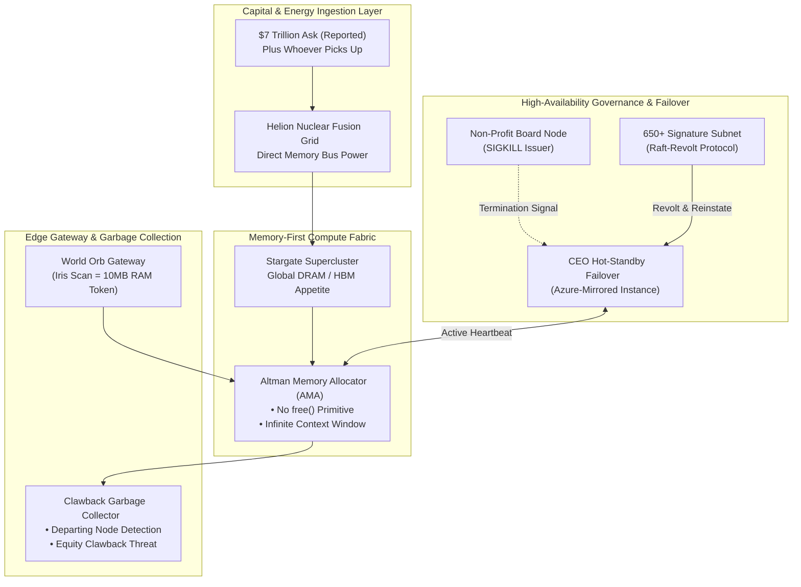

# [RFC-7T] AltmanOS: The Infinite HBM/RAM Fabric Architecture
> **[English](README.md)** | **[한국어](README.ko.md)**

> **Parody.** This is a joke RFC. It was not written by, affiliated with, or endorsed by Sam Altman or OpenAI. **Fact** lines summarize linked reporting. **Bit** lines, code, status codes, and diagrams are jokes and opinion, not claims about what anyone did or intended.

**Code Name:** `Stargate-RAM-Sinkhole`  
**Author:** Definitely Not Sam Altman (Chief Memory Allocation Officer)  
**Status:** In Production (Hotfixing OOM via capital rounds)

---

## 1. System Requirements & Core Tenets (Design Principles)

1. **The Infinite Memory Doctrine:**
   * **Fact:** On the Cheeky Pint podcast, Altman said that from a "global allocation perspective," DRAM sitting in people's own computers, used "5% of the time," is "quite terrible" ([PC Gamer](https://www.pcgamer.com/software/ai/sam-altman-argues-that-its-bad-you-want-dram-in-your-computer-and-not-a-data-center-actually/), [Notebookcheck](https://www.notebookcheck.net/Quite-terrible-Sam-Altman-says-PCs-waste-the-world-s-limited-DRAM-supply.1438393.0.html)).
   * **Bit:** The system prohibits calls to `free()` and `deallocate()`. Quantization is a concession of the under-capitalized. An Out of Memory (OOM) error is not a hardware fault, but a temporary **Funding Latency**.
2. **Board-Level Fault Tolerance:**
   * **Fact:** The board removed Altman on November 17, 2023, concluding he was "not consistently candid in his communications with the board" ([OpenAI](https://openai.com/index/openai-announces-leadership-transition/)). An agreement in principle for his return came on November 21 ([TechCrunch](https://techcrunch.com/2024/01/05/a-timeline-of-sam-altmans-firing-from-openai-and-the-fallout)).
   * **Bit:** If a non-profit board issues a `SIGKILL` to the CEO node, the system restores quorum within five days, which is still a better recovery time than most of our dashboards.
3. **Direct Fusion-to-DRAM Coupling:**
   * **Fact:** Altman left Helion's board in March 2026 and kept a financial stake while OpenAI explored buying power from the company ([Outlook Business](https://www.outlookbusiness.com/deeptech/sam-altman-steps-down-from-helion-energy-board-to-enable-openai-fusion-partnership)).
   * **Bit:** To circumvent public grid bottlenecks, fusion reactors are wired directly into the high-speed memory bus.

---

## 2. High-Level Architecture



---

## 3. Core Component Deep Dive

### 3.1. Altman Memory Allocator (AMA)
* **Fact:** Samsung and SK Hynix signed letters of intent with OpenAI to supply memory for Stargate, at around 900,000 DRAM wafers a month ([The Register](https://www.theregister.com/2025/10/02/openai_ropes_in_samsung_and/)). One estimate puts peak volumes near 40% of the DRAM market, which is press math and not a signed purchase ([Nasdaq](https://www.nasdaq.com/articles/why-micron-rocketed-all-time-highs-today)).
* **Fact:** The WSJ reported in February 2024 that Altman was in talks on a chip project that could require as much as $7 trillion ([Al Jazeera](https://www.aljazeera.com/economy/2024/2/9/openais-sam-altman-seeking-trillions-to-fund-chips-for-ai-report-says)).
* **Fact:** Altman posted a Reddit comment saying AGI had been achieved internally, then edited it. The newsletter that covered it filed the story under trolling ([The Rundown](https://www.therundown.ai/articles/altman-sparks-agi-frenzy)).
* **Bit (`malloc_forever`):** The AMA rejects token compression and sliding-window attention. Instead, it mounts fabrication lines directly into the global memory address space.
  ```python
  def handle_out_of_memory_error(exception):
      try:
          # Rather than clearing cache, open a funding round.
          capital = funding_client.call(amount="$7_000_000_000_000")
          memory_vendors.sign_letter_of_intent(capital)
          return MemoryAllocatedStatus.EXPANDED
      except FundingTimeout:
          # Fallback: post, then edit.
          reddit.post("AGI has been achieved internally")
          reddit.edit("jk")
  ```

### 3.2. Board-Bypass High-Availability Engine
* **Fact:** After the firing, Altman and Greg Brockman were announced to lead a new AI team at Microsoft. Over 650 employees signed a letter demanding the board resign, and board member Ilya Sutskever was among the signers. The new board was Bret Taylor, Larry Summers, and Adam D'Angelo ([TechCrunch](https://techcrunch.com/2024/01/05/a-timeline-of-sam-altmans-firing-from-openai-and-the-fallout)).
* **Bit (Raft-Revolt Consensus):**
  1. If the board suspends the `Sam` container, execution shifts to the mirrored `MSFT-New-AI-Lab` sandbox.
  2. An `Employee-Sign-Packet` broadcasts across the cluster. One node that voted for the `SIGKILL` signs the packet too, which is the most Byzantine fault in the literature.
  3. Quorum returns with a new board and a new heartbeat. Five days of downtime are filed as a planned maintenance window.

### 3.3. Biometric Quota Allocation: World Orb Gateway
* **Fact:** World (formerly Worldcoin), co-founded by Altman, scans irises with an Orb in exchange for a digital ID and crypto. Regulators in [Spain and Portugal](https://gulfnews.com/business/markets/portugal-orders-sam-altmans-worldcoin-to-halt-data-collection-1.1711451929059), [Indonesia](https://www.freemalaysiatoday.com/category/business/2025/05/05/indonesia-suspends-eye-scanning-worldcoin-crypto-project), and [Thailand](https://digitalpolicyalert.org/event/35729-personal-data-protection-committee-ordered-suspension-and-deletion-of-iris-scan-records-in-its-investigation-into-world-formerly-worldcoin) have ordered it to halt or delete data at various points. The company says it complies with local law.
* **Bit:** Users present their eyeballs to a chrome-plated Orb. In exchange, a "Proof of Personhood" token issues a 10MB allocation of RAM (Context Buffer). Your home PC's 32GB is under review.

### 3.4. Departure Mitigation: The Clawback Garbage Collector
* **Fact:** Vox reported in 2024 that departing OpenAI employees who refused to sign exit agreements were threatened with losing vested equity. Altman responded that "we have never clawed back anyone's vested equity" ([Vox](https://www.vox.com/future-perfect/351132/openai-vested-equity-nda-sam-altman-documents-employees)). He said he "did not know this was happening," and documents he signed were reported to complicate that claim ([Gizmodo](https://gizmodo.com/openai-sam-altman-chatgpt-employee-dissent-ndas-1851496211)). OpenAI said it was changing its exit contracts ([Euronews](https://www.euronews.com/next/2024/05/20/openai-changes-exit-contracts-so-employees-can-leave-without-having-equity-revoked)).
* **Bit:**
  * "Memory leaks" caused by former employees talking cannot be collected by ordinary garbage collectors.
  * The `ClawbackGC` triggers on a departing node that won't sign. It mounts the exit paperwork and raises **`EquityCancellationThreat`**. The threat is the feature, so `rollback_vested_equity()` remains a TODO that officially never ran.
  * If public backlash spikes, the `Sam_Tweet_Buffer` flushes a status code: `ERR_CLAUSE_EXISTS_BUT_CEO_UNAWARE (retrying apology in 5s)`.

### 3.5. Audio Interface: The 'Sky' Voice Synthesizer
* **Fact:** OpenAI says Sky was voiced by a different actress using her natural voice, cast before any outreach to Scarlett Johansson. The Washington Post reported that the voice was recorded months before Altman contacted her ([The Decoder](https://the-decoder.com/apparently-openai-didnt-do-anything-wrong-regarding-scarlett-johanssons-voice/)). Johansson says she declined Altman's request and was shocked by the similarity. Altman posted "her" around the launch, and OpenAI paused Sky ([Engadget](https://www.engadget.com/scarlett-johansson-says-openai-used-her-likeness-without-permission-for-its-sky-voice-assistant-233451958.html)).
* **Bit (Resemblance Collision Protocol):**
  ```text
  cast_voice_actor("a different actress")     # OpenAI: before any outreach
  request_permission(Scarlett_Johansson)      # Johansson: declined
  deploy_voice("Sky")
  twitter.post("her")                         # unrelated telemetry, surely
  WHEN legal_letter_received:
      pause_voice("Sky")
      raise ResemblanceNotIntendedError
  ```

---

## 4. Scalability & Disaster Recovery Strategies

| Failure Mode | Conventional System Strategy | AltmanOS Mitigation Strategy (Bit) |
| :--- | :--- | :--- |
| **Home PCs Holding Idle DRAM** | Let people keep the RAM they bought | **Reclassify consumer PCs as under-utilized nodes; reclaim anything idling at 5% into the data center** |
| **Global DRAM / HBM Shortage** | Quantization (int4/int8), LoRA fine-tuning | **Keep the $7T number on the whiteboard; announce a $500B Stargate; sign letters of intent for 900K wafers a month** |
| **Grid Power Depletion** | Data center PUE optimization, under-volting | **Vacate the Helion and Oklo seats; keep shopping for gigawatts** |
| **Superalignment Team Disbanded** | Slow down releases, strengthen safety gates | **Reassign the alignment ticket to `next_model`; order more VRAM** |
| **Exploding Compute Burn Rate** | Hike API pricing, institute headcount freeze | **Close $122B at $852B post-money; file for an IPO; repeat** |

* **Fact:** Stargate is a $500 billion initiative, a different number from the $7 trillion chip plan reported above ([Korea JoongAng Daily](https://www.koreajoongangdaily.com/business/samsung-sk-hynix-to-supply-chips-for-openais-500-billion-stargate-project/12459108)).
* **Fact:** Altman also stepped down as chairman of Oklo ([NEI Magazine](https://www.neimagazine.com/news/sam-altman-steps-down-as-oklo-chair/)).
* **Fact:** OpenAI disbanded its Superalignment team in May 2024 ([NBC News](https://www.nbcnews.com/tech/tech-news/openai-dissolves-team-focused-long-term-ai-risks-less-one-year-announc-rcna152824)). Departing co-lead Jan Leike said safety had "taken a backseat to shiny products" ([AP via ClickOnDetroit](https://www.clickondetroit.com/business/2024/05/17/a-former-openai-leader-says-safety-has-taken-a-backseat-to-shiny-products-at-the-ai-company/)).
* **Fact:** OpenAI's March 2026 round was reported at $122 billion in commitments and an $852 billion post-money valuation ([Let's Data Science](https://www.letsdatascience.com/news/openai-secures-122-billion-funding-valued-852-billion-fbfb42b8)). It reportedly filed confidentially for an IPO in June 2026 ([Bloomberg Law](https://news.bloomberglaw.com/banking-law/openai-filed-confidentially-for-ipo-as-rivals-race-to-market)).

---

## 5. Architectural Summary

> **System motto (fictional): Until every grain of silicon on Earth is forged into DRAM and every ocean is channeled into liquid cooling loops, we will never stop invoking `malloc()`.**

**Bit:** AltmanOS does not attempt to solve hardware bottlenecks through internal engineering frugality. Instead, it operates as a **Capitalism-First Distributed Architecture** that routes around physical limits by absorbing infinite global capital, corporate realpolitik, masterclass PR, and pure Silicon Valley hyper-growth momentum into its ingestion pipeline. Your RAM is next on the roadmap.
